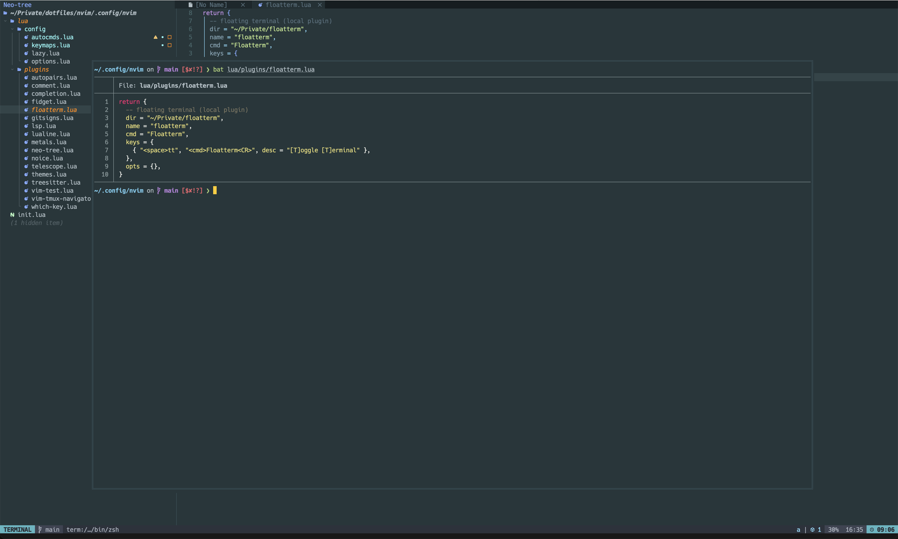

# floatterm

Minimal Neovim plugin that toggles a persistent terminal in a centered floating window.

- One terminal buffer, reused across toggles — hide it, come back later, your shell session is still there.
- Window stays centered when Neovim is resized.
- When the shell exits, the buffer is wiped so the next toggle starts a fresh shell.
- No dependencies, ~150 lines of Lua.

> Inspired by one of [TJ DeVries](https://www.youtube.com/@teej_dv)' YouTube videos on building a floating terminal in Neovim.



## Requirements

- Neovim >= 0.9 (`title` option needs 0.9+)

## Installation

### [lazy.nvim](https://github.com/folke/lazy.nvim)

```lua
{
  "RafalKucab/floatterm",
  cmd = "Floatterm",
  keys = {
    { "<space>tt", "<cmd>Floatterm<CR>", desc = "[T]oggle [T]erminal" },
  },
  opts = {}, -- calls require("floatterm").setup({})
}
```

Local checkout (development):

```lua
{
  dir = "~/Private/floatterm",
  name = "floatterm",
  cmd = "Floatterm",
  keys = {
    { "<space>tt", "<cmd>Floatterm<CR>", desc = "[T]oggle [T]erminal" },
  },
  opts = {},
}
```

### [packer.nvim](https://github.com/wbthomason/packer.nvim)

```lua
use({
  "RafalKucab/floatterm",
  config = function()
    require("floatterm").setup()
  end,
})
```

### vim-plug

```vim
Plug 'RafalKucab/floatterm'
lua require("floatterm").setup()
```

### Native packages

```sh
git clone https://github.com/RafalKucab/floatterm \
  ~/.local/share/nvim/site/pack/plugins/start/floatterm
```

## Configuration

`setup()` is optional — defaults are used without it. All options:

```lua
require("floatterm").setup({
  width = 0.8,          -- fraction of editor width (<= 1) or absolute columns (> 1)
  height = 0.8,         -- fraction of editor height (<= 1) or absolute lines (> 1)
  border = "double",    -- any border accepted by nvim_open_win ("single", "rounded", ...)
  title = nil,          -- e.g. " Terminal "
  cmd = nil,            -- command to run instead of 'shell', e.g. "lazygit"
  start_insert = false, -- enter terminal mode right after opening
  exit_key = "<Esc><Esc>", -- leave terminal mode (buffer-local); false to disable
})
```

## Usage

| Command             | Action                                  |
| ------------------- | --------------------------------------- |
| `:Floatterm`        | Toggle the floating terminal            |
| `:Floatterm open`   | Open (or focus) the floating terminal   |
| `:Floatterm close`  | Hide the floating terminal              |

Lua API:

```lua
local ft = require("floatterm")
ft.toggle()
ft.open()
ft.close()
ft.is_open() -- boolean
```

Leave terminal mode with `<Esc><Esc>` (configurable via `exit_key`) or the built-in `<C-\><C-n>`.
A single `<Esc>` is still passed to the shell, so programs like `fzf` or `vim` inside the terminal keep working.
